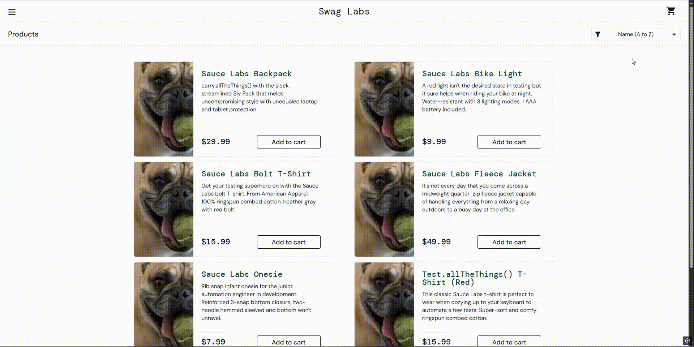

# BUG-006 — `problem_user`: Product Sorting Does Not Work

## Bug Information

| Field | Details |
|---|---|
| **Bug ID** | BUG-006 |
| **Related Test Cases** | TC-045 |
| **Bug Type** | Functional |
| **Severity** | Medium |
| **Priority** | Medium |
| **Status** | New |

## Environment

| Field | Details |
|---|---|
| **Operating System** | Windows 10 Home |
| **Browser** | Google Chrome 154.0.8037.98 |
| **Application** | SauceDemo |
| **URL** | https://www.saucedemo.com/ |

## Test Account

`problem_user`

## Preconditions

- User is logged in using the `problem_user` account.
- User is on the Products page.

## Steps to Reproduce

1. Open the **Sort** dropdown.
2. Select **Name (Z to A)**.
3. Observe the product order.
4. Select **Price (low to high)**.
5. Observe the product order.
6. Select **Price (high to low)**.
7. Observe the product order.

## Expected Result

The products should be reordered according to the selected sorting option:

- **Name (Z to A):** Products are displayed in descending alphabetical order.
- **Price (low to high):** Products are displayed in ascending price order.
- **Price (high to low):** Products are displayed in descending price order.

## Actual Result

Selecting any of the three sorting options did not change the product order. The products remained in **Name (A to Z)** order regardless of the selected option.

## User Impact

Users cannot arrange products according to their preferred sorting option. This makes it harder to find products by name or price and reduces the usability of the product catalog.

## Evidence

