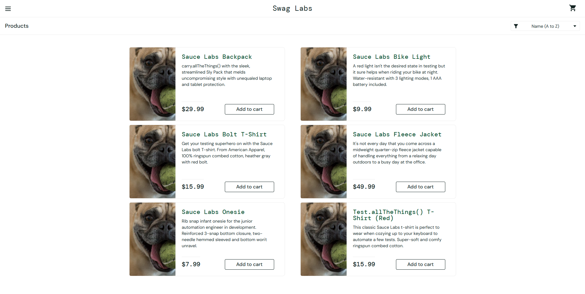

# BUG-010 — `problem_user`: Products Display the Wrong Images

## Bug Information

| Field | Details |
|---|---|
| Bug ID | BUG-010 |
| Related Test Cases | TC-049 |
| Bug Type | Functional |
| Severity | Medium |
| Priority | Medium |
| Status | New |

## Environment

| Field | Details |
|---|---|
| Operating System | Windows 10 Home |
| Browser | Google Chrome 158.0.8127.36 |
| Application | SauceDemo |
| URL | https://www.saucedemo.com/ |

## Test Account

`problem_user`

## Preconditions

- User is logged in using the `problem_user` account.
- User is on the Products page.

## Steps to Reproduce

1. Locate the six products displayed on the **Products page**.
2. Observe the image displayed for each product.
3. Compare the displayed images with their corresponding product names and expected images.

## Expected Result

Each product should display its corresponding product image.

## Actual Result

All six products displayed the same image of a pug holding a tennis ball instead of their expected product images.

## User Impact

Users may have difficulty visually identifying products due to the incorrect images. This can reduce confidence in the website and negatively affect the browsing experience. However, users can still identify products through their names and descriptions and add them to the cart.

## Evidence

